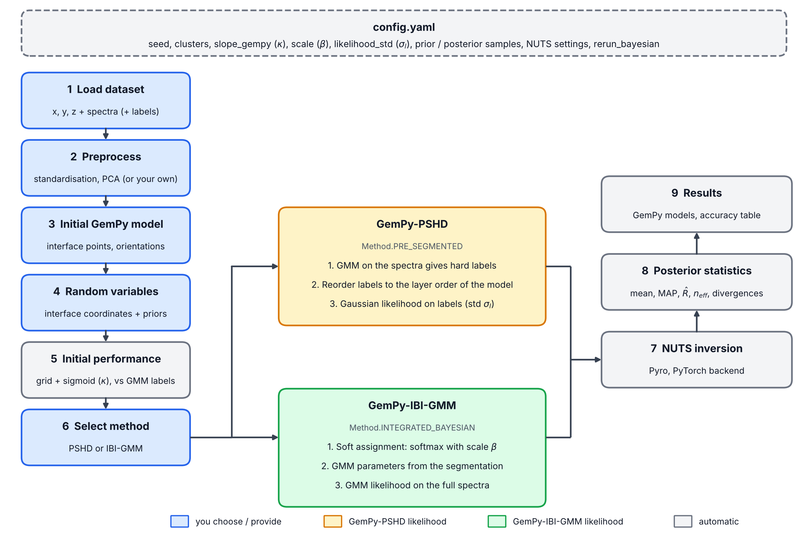

# GempyHSI

Bayesian inversion of geological models using hyperspectral image (HSI)
observations, combining [GemPy](https://www.gempy.org/) (geological
modeling) with [Pyro](https://pyro.ai/) (probabilistic programming /
NUTS-MCMC).

## Workflow Overview



## 🧠 Methodology

GempyHSI implements Bayesian inversion of geological models using
hyperspectral images through two complementary methods, depending on
what information is available in the observations.

---

### Method 1: `PRE_SEGMENTED`

Used when **label information is available**, or when the hyperspectral
image can first be segmented into discrete classes (e.g. via GMM).

1. Derive pixel-wise labels — either from `dataset.labels` if given, or
   by fitting a Gaussian Mixture Model to the spectral features and
   re-ordering cluster indices by depth (since raw GMM/K-means labels
   have no inherent geological ordering; see `post_processing.py`).
2. Use these labels as a scalar observation and compare them against
   GemPy's continuous scalar output with a simple Gaussian likelihood.
3. Infer the geological interface parameters via NUTS/MCMC.

**Use case:** efficient when a segmentation already exists, or a
label can be reasonably derived from the spectral features.

---

### Method 2: `INTEGRATED_BAYESIAN`

Used for **full hyperspectral data**, treating the high-dimensional
spectra directly rather than reducing them to a label first.

1. Use the full per-pixel spectral vector as the observation.
2. Treat a Gaussian-Mixture likelihood as the inversion's likelihood
   function directly: soft cluster assignments (`gamma_nk`, via a
   softmax over GemPy's scalar output) are combined with a per-cluster
   multivariate Gaussian over the spectral features.
3. Infer geological parameters and class assignments jointly via
   NUTS/MCMC.

**Use case:** no pre-labeling step required; lets the inversion learn
class structure and geological parameters simultaneously. More
expensive than `PRE_SEGMENTED`, but avoids committing to a hard label
before inversion.

---

Both methods share the same prior-sampling / layer-ordering machinery
(`prior.py`), the same GemPy model construction (`model_existing.py`),
and the same MCMC driver (`bayesian.py`); only the likelihood differs
(`pre_segmented.py` vs. `integrated_bayesian.py`).

## 🐍 Environment Setup

Requires **Python 3.10.13**.

```bash
conda create -n gempy_env python=3.10.13
conda activate gempy_env

pip install \
  gempy==2023.2.0b1 \
  gempy-engine==2023.2.0b1 \
  gempy-probability==2023.2.0b1 \
  gempy-viewer==2023.2.0b1

pip install pyro-ppl arviz pandas scikit-learn pyyaml
```

Or, if an `environment.yml` is provided in this repo:

```bash
conda env create -f environment.yml
conda activate gempy_env
```

## 📂 Repository Layout

```
GempyHSI/
├── Datasets/
│   ├── Fw__Hyperspectral_datasets_from_the_KSL_cores/
│   └── HSI_Salinas/
└── HSI/
    ├── Results/                    # all run outputs (see "Output Directory Structure" below)
    ├── config.yaml                 # default run configuration
    ├── run_config.py               # RunConfig dataclass + directory builders
    ├── Dataset_loader.py           # main() entry point, dataset selection, pipeline glue
    ├── seeding.py                  # RNG seeding (Python/NumPy/torch/Pyro) for reproducibility
    ├── preprocessing.py            # standardize() / apply_pca() / preprocess_dataset()
    ├── prior.py                    # shared prior sampling + layer-ordering constraint
    ├── pre_segmented.py            # PRE_SEGMENTED Pyro model
    ├── integrated_bayesian.py      # INTEGRATED_BAYESIAN Pyro model
    ├── model_existing.py           # GemPy initial/final model construction
    ├── bayesian.py                 # NUTS/MCMC driver, saves results + plots
    ├── performance_matrix.py       # accuracy / internal-validity metrics
    ├── posterior_analysis.py       # posterior statistics, MAP/mean/±std realizations
    └── post_processing.py          # pseudo-labels, cluster re-ordering, plotting from saved results
```

## 🗂 Dataset Format Requirements

GempyHSI expects every dataset (predefined or user-supplied) to be a
`UserDataset` with:

**`dataset.data`** — 2D array/tensor of shape `(num_pixels, num_features)`

- **Columns 0–2:** `x, y, z` spatial coordinates of each pixel.
- **Columns 3+:** spectral bands / features at that pixel (optional —
  a purely spatial dataset with only 3 columns is valid too).

**`dataset.labels`** — optional 1D array of per-pixel class labels.
Required for `PRE_SEGMENTED` on a dataset without a way to derive
pseudo-labels; not required for `INTEGRATED_BAYESIAN`.

```text
dataset.data = [
  [x1, y1, z1, f1_1, f1_2, ..., f1_N],
  [x2, y2, z2, f2_1, f2_2, ..., f2_N],
  ...
]
```

### Using a pre-defined dataset

```python
dataset = select_dataset(name="SalinasA")
# dataset = select_dataset(name="KSL_layer3")
# dataset = select_dataset(name="Syn_label")
# dataset = select_dataset(name="Syn_label_shift")
```

### Using a custom dataset

```python
dataset = select_dataset(data=my_data_array, labels=my_labels_array)
```

*(If a standalone custom-dataset loader — e.g. reading directly from a
`.csv`/`.npy`/`.pt` file path — lives in a separate module in your
current code, update this snippet to import from it; it wasn't in the
file list I was given, so I've left this as the array-based form.)*

## ⚙️ Configuration (`RunConfig`)

All tunable parameters for a run live in `run_config.py`'s `RunConfig`
dataclass, loadable from (and archivable as) a YAML file:

```python
from run_config import RunConfig

config = RunConfig.from_yaml("config.yaml")
```

```yaml
seed: 42
clusters: 6
directory_path: "./Results"
slope_gempy: 45.0      # sigmoid slope of GemPy (kappa in the paper)
scale: 10.0            # softmax scale, INTEGRATED_BAYESIAN only (beta in the paper)
likelihood_std: 0.4    # likelihood std, PRE_SEGMENTED only (sigma_l in the paper)
enforce_ordering: true
rerun_bayesian: true
prior_number_samples: 1000
posterior_number_samples: 250
posterior_warmup_steps: 250
posterior_num_chain: 5
step_size: 0.0085
adapt_step_size: true
target_accept_prob: 0.75
max_tree_depth: 10
```

Three of these parameters have a symbol in the paper:

| Config key | Symbol | Meaning | Used by |
|---|---|---|---|
| `slope_gempy` | $\kappa$ | Sigmoid slope of GemPy; a parameter that GemPy uses | both methods |
| `likelihood_std` | $\sigma_l$ | Standard deviation of the Gaussian likelihood on the labels | `PRE_SEGMENTED` |
| `scale` | $\beta$ | Scale of the softmax that assigns each pixel to a segment | `INTEGRATED_BAYESIAN` |

`dataset` and `method` are **not** config fields — the dataset is
chosen at the top of `main()` (`select_dataset(...)`), and the method
is chosen only after inspecting the *initial* performance matrix (see
below), so both are passed explicitly wherever they're needed rather
than fixed in the config up front.

### ⚠️ Dataset-specific notes for `slope_gempy` ($\kappa$) / `clusters`

| Dataset | Recommended `slope_gempy` ($\kappa$) | `clusters` |
|---|---|---|
| Synthetic, KSL / KSL_layer3 | 200.0 | 3 |
| SalinasA | 45.0 | 6 |

Keep these aligned with your dataset; for a custom dataset, you'll
likely need to sweep `slope_gempy` ($\kappa$) to find a value that gives a
reasonably sharp (but not degenerate) sigmoid response.

## 📁 Output Directory Structure

Every run writes into a nested `Results/` hierarchy so that different
datasets, methods, and hyperparameter settings never overwrite each
other, and every experiment can be found and compared later without
hand-tracking paths:

```
Results/
└── {dataset_name}/
    ├── initial_model.png                    # <- config.initial_output_dir(dataset_name)
    └── {method_name}/
        └── {param_string}/                  # <- config.run_output_dir(dataset_name, method_name)
            ├── config.yaml                  # archived copy of the exact config used
            ├── model_graph.png
            ├── prior.png
            ├── posterior.png
            ├── mu_1.png, mu_2.png, ...
            ├── mcmc_summary.txt
            ├── bayesian_results.pt          # raw MCMC output (torch.save)
            ├── inference_data.nc            # arviz InferenceData (for later postprocessing)
            ├── posterior_summary.csv
            └── matrix.csv                   # initial AND final performance matrix, combined
```

`matrix.csv` holds both the initial (pre-inversion) performance matrix
and the final one, in a single table — one column per realization
(initial model, GMM baseline, K-means baseline, plus the inverted
model's MAP/mean/±1 std realizations). It's written once, at the end
of the run, into `run_dir` rather than split across `initial_dir` and
`run_dir`.

There is no saved copy of the custom grid coordinates. The grid is
just the dataset's own spatial columns (`dataset.data[:, 0:3]`) — the
locations where the spectral measurements already live — so it's
fully reconstructible from the input dataset and isn't treated as a
run output.

`{param_string}` encodes only the hyperparameters that actually affect
*that* method's behavior — `PRE_SEGMENTED` runs are named by
`likelihood_std` ($\sigma_l$; not `scale`, which it never uses);
`INTEGRATED_BAYESIAN` runs are named by `scale` ($\beta$; not
`likelihood_std`). Both are named by `posterior_warmup_steps`,
`posterior_number_samples`, `posterior_num_chain`, `slope_gempy`
($\kappa$), and `enforce_ordering`, since those affect both methods.

Two directory-builder methods on `RunConfig` produce these paths (and
create the directories if missing):

```python
initial_dir = config.initial_output_dir(dataset_name)
run_dir     = config.run_output_dir(dataset_name, method.value)
```

Nothing downstream should build a `Results/...` path by hand — every
function that saves a plot, CSV, or `.pt`/`.nc` file takes an
`output_dir: Path` argument and joins onto it with `/`.

## 🚀 Running GempyHSI

The pipeline runs end-to-end from `Dataset_loader.py`'s `main()`:

1. **Load and preprocess the dataset**
   ```python
   dataset = select_dataset(name="SalinasA")
   dataset_final = preprocess_dataset(dataset)
   initial_dir = config.initial_output_dir(dataset_final.name)
   ```

2. **Build the initial GemPy model** and set up the custom grid at the
   dataset's spatial coordinates.

3. **Declare which interface points are random variables**, with their
   priors (see "Defining Random Variables" below).

4. **Compute the initial performance matrix** — accuracy against
   ground truth (if available), computed once and reused. This is what
   informs the choice of method. Optionally, the code also computes
   internal validity metrics (silhouette, Davies-Bouldin,
   Calinski-Harabasz) against GMM/K-means baselines; these are an
   extra and are not part of the results reported in the paper. The
   returned `matrix` dict is held in memory and
   extended with the final results in step 7 — it isn't written to
   disk until then:
   ```python
   matrix, label_data = calculate_matrix(
       dataset=dataset_final, model_output=model_output,
       n_clusters=config.clusters, seed=config.seed,
       classical_method=True,
   )
   ```

5. **Choose the method** and derive its output directory:
   ```python
   method = Method.INTEGRATED_BAYESIAN   # or Method.PRE_SEGMENTED
   run_dir = config.run_output_dir(dataset_final.name, method.value)
   ```
   For `PRE_SEGMENTED` on a dataset with spectral features but no
   ground truth, pseudo-labels are derived from the GMM baseline
   already computed in step 4 (reusing `label_data["GMM"]`, aligned to
   the model's own class ordering via `cluster_acc` — see
   `post_processing.py`), rather than refitting a GMM from scratch.

6. **Run (or load) the Bayesian inversion**:
   ```python
   results_path = run_dir / "bayesian_results.pt"
   if config.rerun_bayesian or not results_path.exists():
       bayesian_results = run_bayesian(
           dataset=dataset_final, geo_model_init=geo_model_init,
           geo_model_final=geo_model_final, config=config,
           random_variable=random_variable, method=method,
           pre_seg_labels=pre_seg_labels, output_dir=run_dir,
       )
   else:
       bayesian_results = torch.load(results_path, weights_only=False)
   ```
   Setting `rerun_bayesian: false` in the config skips the (expensive)
   MCMC run and reloads the saved `bayesian_results.pt` instead —
   useful for iterating on postprocessing/plotting without re-running
   inference.

7. **Compute posterior statistics and the final performance matrix**,
   both written into `run_dir`:
   ```python
   from posterior_analysis import calculate_posterior_statistics
   statistics = calculate_posterior_statistics(bayesian_results, config, run_dir)
   output_segmentation = realization_to_gempy_model(
       statistics=statistics, geo_model_init=geo_model_init,
       geo_model_final_fn=geo_model_final, random_variable=random_variable,
       custom_grid=custom_grid, config=config, output_dir=run_dir,
   )
   ```
   `calculate_matrix` is then re-run per posterior realization (MAP,
   mean, ±1 std), and its results are merged into the `matrix` dict
   from step 4. The combined table — initial model, GMM/K-means
   baselines, and every posterior realization, all in one place — is
   written once as `run_dir/matrix.csv`.

## 🎯 Defining Random Variables in the GemPy Model

Interface points to treat as random variables are declared as a list
of dicts, each specifying which surface point index to perturb, along
which axis, and with what prior:

```python
random_variable = [
    {
        "update": "interface_data",
        "id": torch.tensor([1]),
        "direction": "Z",
        "prior_distribution": "normal",
        "normal": {
            "mean": torch.tensor(normalised_coord[1, 2], dtype=data_type, device=device),
            "std": torch.tensor(0.3, dtype=data_type, device=device),
        },
    },
    # ... one entry per interface point to perturb
]
```

- `id` — index of the interface point in the GemPy surface-points table.
- `direction` — which coordinate to vary (`"X"`, `"Y"`, or `"Z"`).
- `prior_distribution` — `"normal"` or `"uniform"`.
- `mean`/`std` (or `min`/`max` for uniform) — the prior's parameters,
  typically centered on the point's current coordinate.

`enforce_ordering` (in `RunConfig`) applies a monotonic
`mu_1 > mu_2 > ... > mu_n` constraint across the declared interfaces
during inference — set to `false` to compare inversion behavior
without it, or if ordering is otherwise guaranteed.

## 📊 Interpreting Results

- **`posterior.png`** — trace plots for all sampled parameters.
- **`mu_i.png`** — per-parameter prior-vs-posterior density comparison.
- **`mcmc_summary.txt`** — N_eff, R-hat, and divergence counts per
  parameter; aim for R-hat in `[0.99, 1.01]` and N_eff greater than or equal to about 400 before trusting the posterior for reporting.
- **`matrix.csv`** — accuracy (against ground truth, when available)
  for the model's MAP/mean/±std realizations, alongside the GMM
  baseline. The optional internal-validity metrics and the K-means
  baseline appear here too when they are enabled (not used in the
  paper).

## Datasets

`Datasets/` contains the hyperspectral datasets used in this project:

- **`Fw__Hyperspectral_datasets_from_the_KSL_cores/`** — from the
  Spremberg Site, Germany. Recommended `slope_gempy` ($\kappa$) = 200.
- **`HSI_Salinas/`** — the Salinas hyperspectral dataset (typically the
  SalinasA subset). Recommended `slope_gempy` ($\kappa$) = 45.

## Citing

